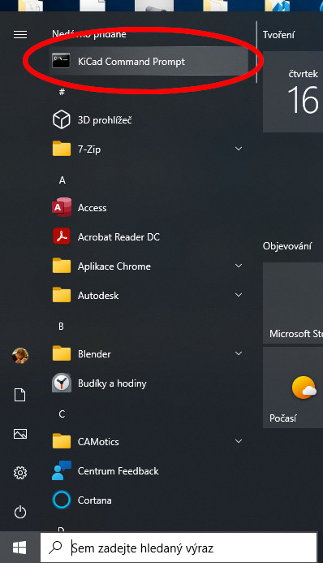
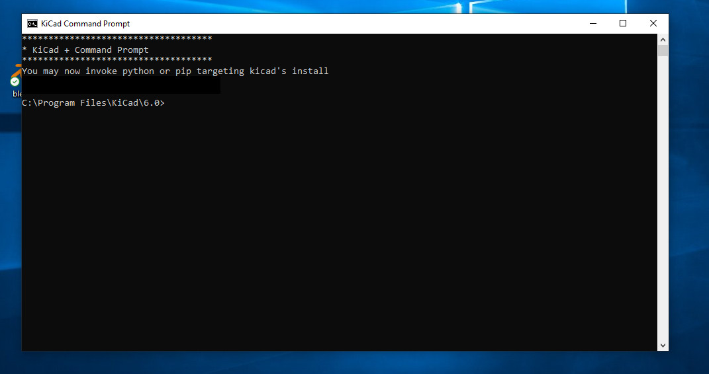

# Installation

PcbDraw is a stand-alone CLI tool. It is not an action plugin for KiCad and
therefore, it has no menu inside the PCB Editor. PcbDraw supports **KiCad 9 and 10**.
It communicates with KiCad through the `kicad-cli` executable and does not load
the version-specific Python `pcbnew` module.

## Linux & MacOS

PcbDraw is distributed as a Python package. On most of the Linux distributions
you just have to install KiCAD and then install PcbDraw via Pip:

```
pip install PcbDraw # Use pip or pip3 based on your distribution
```

If you would like to use the upstream (unstable) version of PcbDraw, you can
install it directly from GitHub:

```
pip3 install git+https://github.com/yaqwsx/PcbDraw@master
```

PcbDraw also requires either Inkscape 1.x or librsvg installed to perform
conversion from vector to raster images. The executables `inkscape` or
`rsvg-convert` have to be in PATH. Optionally, you can specify environmental
variables `PCBDRAW_INKSCAPE` or `PCBDRAW_RSVG` with paths to the tools. If they
are set, PcbDraw will use these paths.

The `kicad-cli` executable must be available in `PATH`. For installations in a
non-standard location, set `KICAD_CLI` to its full executable path.

## Windows

On Windows, install a supported KiCad release and Inkscape 1.x. PcbDraw doesn't work with
Inkscape 0.9x. You can use an ordinary command prompt when `kicad-cli` is in
`PATH`. Otherwise, use the "KiCad Command Prompt" from the start menu or set
`KICAD_CLI` explicitly:



Once you have it open like this:



you can enter commands and confirm them by pressing Enter. Use that prompt when
the normal command prompt cannot find `kicad-cli`.

Then you have to enter:

```
pip install PcbDraw
```

Now you can test that it works:

```.bash
pcbdraw --help
```

You should get a help menu.

PcbDraw itself can be installed into any normal Python environment; it no
longer has to share KiCad's bundled Python environment.

## Docker

Simply follow the [guide for running KiKit inside a docker
container](https://github.com/yaqwsx/KiKit/blob/master/doc/installation.md#running-kikit-via-docker)
as the KiKit image contains also PcbDraw.
